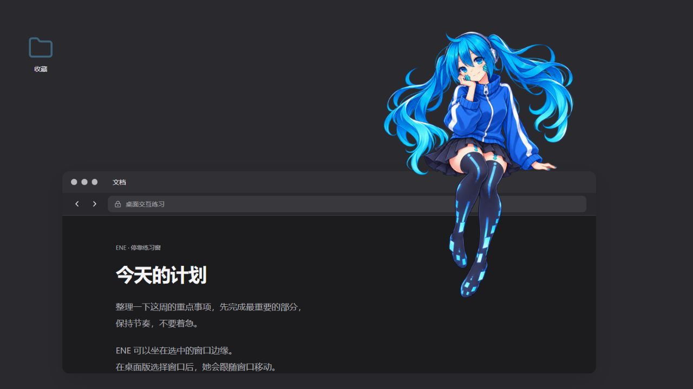

# ENE Desktop

[中文说明](项目说明.md) · English

A desktop companion that can sit on a window edge or rest on your desktop. Brief speech bubbles disappear; click the character to reopen conversation history.

**Backend framework: [DeepSeek Harness (DSH)](https://github.com/deepseek-ai/deepseek-harness).** The desktop shell uses Electron and React; DSH runs through a separate Node process. The pinned runtime is `0.2.2-alpha.2`.

## Character artwork

All three images are included for noncommercial use and adaptation with attribution.

| Idle | Seated | Prone |
|:---:|:---:|:---:|
|  |  |  |

## Window perching



This image illustrates the interaction. The native Windows prototype can follow the top edge of an explicitly selected real window and detach when dragged or when that window is minimized or closed.

## Current progress

- Independent transparent character, dragging, scaling, tray and separate settings.
- Five-second bubbles and on-demand current-run history.
- Three static poses and optional rest switching after 90 seconds without interaction.
- Windows system voice audition, speech pace, demo-reply narration and interruption.
- Real DSH runtime connected to a local synthetic endpoint; **real model conversations are not connected yet**.
- External local-neural-TTS benchmarks; Live2D part preparation, without a finished rig or animation.

The local Windows package passed 20 native checks. Encrypted memory, cross-device synchronization, Mac and mobile clients remain future work. See [progress](docs/progress/2026-10-29.en.md) and the [document index](docs/文档目录.md).

## Run

Install Node 24.9+:

```sh
cd apps/ene-desktop
npm ci
npm run desktop
```

On Windows, preparation compiles the geometry and speech helpers. Build and basic tests:

```sh
npm run build
npm test
```

For synthetic DSH checks, run from the repository root:

```sh
npm ci --prefix runtime/dsh
node tools/verify-dsh.mjs
```

No API key is needed for this demo. Future provider credentials stay local and must not be committed. Voice models and source recordings are not included.

## License

**Noncommercial use; retain attribution and source when sharing or modifying.** Code: PolyForm Noncommercial 1.0.0. Documentation and the three character images: CC BY-NC 4.0. Credit `Pain-ENE / ENE Desktop` and link to this repository. See [license details](使用许可.md). Dependencies retain their own licenses.
